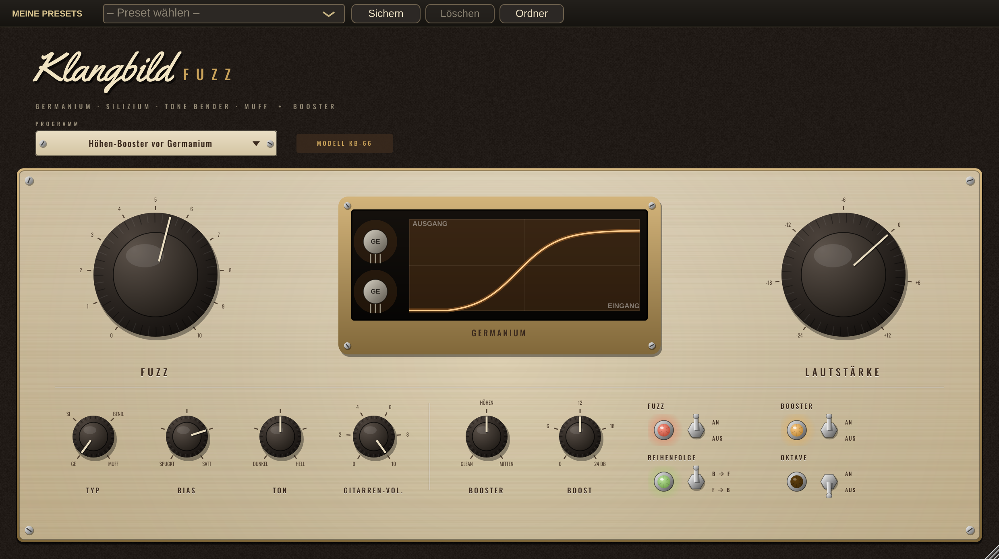

# Klangbild Fuzz

Fuzz und Booster in einem Gerät: Germanium, Silizium, Tone Bender und Muff, dazu ein Clean-, Höhen- oder
Mitten-Booster – wahlweise vor oder hinter dem Fuzz. Audio Unit für Logic Pro (außerdem VST3 und Standalone),
gebaut mit [JUCE](https://juce.com). Gehört direkt hinter die Gitarre, vor das Amp-Profil (NAM).



## Bedienung

| Regler | Wirkung |
|---|---|
| **Fuzz** | Verzerrung |
| **Lautstärke** | Ausgang ±; bei 0 dB etwa −14 dBFS – wie ein echtes Pedal heißer als die Gitarre |
| **Typ** | *Germanium* (warm, rund, klart mit dem Gitarren-Volume auf) · *Silizium* (heller, mehr Gain) · *Tone Bender* (drei Transistoren, mittiger, britisch) · *Muff* (zwei Diodenstufen, viel Sustain, Mitten-Senke) |
| **Bias** | Arbeitspunkt: SATT = rund · links = „ausgehungert“, spuckt und reißt ab |
| **Ton** | dunkel ↔ hell; beim Muff blendet er zwischen Bass und Höhen (mit Mitten-Senke) |
| **Gitarren-Vol.** | wirkt wie das Volume-Poti der Gitarre: Germanium und Tone Bender klaren beim Zurückdrehen auf |
| **Booster** | *Clean* (lauter), *Höhen* (Treble-Booster der 60er), *Mitten* (Solo-Boost mit Buckel bei 720 Hz) |
| **Boost** | 0–24 dB |
| **Reihenfolge** | B → F: Booster treibt den Fuzz · F → B: Booster als Solo-Pegel dahinter |
| **Oktave** | Gleichrichter: eine Oktave nach oben, am deutlichsten auf den hohen Lagen |

Das Fenster zeigt die Kennlinie der Fuzz-Stufe und den Bereich, den die Gitarre gerade durchläuft.

Vierfache Überabtastung gegen Aliasing; Latenz 4 Samples (wird an Logic gemeldet).

### Presets
Standard · Germanium – warm & rund · Germanium – aufgeklart (Volume 60 %) · Silizium – Solo · Tone Bender – britisch ·
Muff – Wand aus Sustain · Oktav-Fuzz · Gespuckt – Bias niedrig · Höhen-Booster vor Germanium ·
Nur Booster – Höhen (vor den Amp) · Nur Booster – Mitten (Solo) · Fuzz + Solo-Boost dahinter

### Messwerte (Gitarren-Phrase −28 dBFS RMS)
- Alle vier Fuzz-Typen bei Lautstärke 0 dB: −13,9 … −14,3 dBFS RMS
- Gitarren-Volume 70 / 50 %: −18 / −27,5 dBFS – der Germanium-Fuzz klart auf
- Booster 12 dB: Clean +11,4 dB, Höhen +11,3 dB, Mitten +11,2 dB

## Installation in Logic Pro

Am einfachsten über den [Klangbild-Installer](https://github.com/Guitoli1/KlangbildInstaller):

```bash
curl -fsSL https://raw.githubusercontent.com/Guitoli1/KlangbildInstaller/main/install.sh | bash
```

## Selbst bauen

```bash
cmake -B build -G Ninja -DCMAKE_BUILD_TYPE=Release
cmake --build build
```
